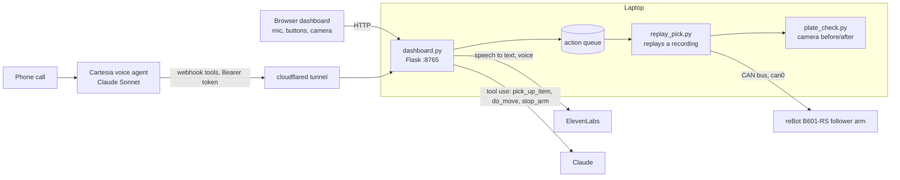

# reBot Voice Arm

Talk to a robot arm and it does things: by voice in the browser or by phone call.

Built at the **Revolute robotics hackathon** (FabLab Kendall, Cambridge, Nov 2026) on a Seeed **reBot B601-RS**
six-joint arm with [LeRobot](https://github.com/Seeed-Projects/lerobot). Every skill is learned from a single human
demonstration with a leader arm, then replayed; a camera checks the result.

> **About this folder.** This is a standalone hackathon project for the same reBot B601-RS arm as this
> workspace. It drives the arm with LeRobot over SocketCAN (`can0`), **not** through MoveIt Pro, and is not part
> of the colcon build (`hackathon/COLCON_IGNORE`). Don't run it while a MoveIt Pro hardware config owns the arm.
> The recorded demonstrations (`data/item_*`, ~54 MB) are not included here; record your own with
> `./teleop.sh pick ITEM N` (see [Teaching it](#teaching-it)). `data/chosen.json` is kept as an example.

- **"Pick up item 2"**: the arm picks the item off the table, drops it on a plate, and the camera confirms it landed.
- **"Do the wave"**, **"dance"**: plays a recorded move.
- **"Grab the tape, then dance twice"**: Claude breaks the request into steps and queues them.
- **"Stop"**: always works, from any input.
- **Call +1 phone number**: the same robot, over a normal phone call (Cartesia voice agent).

## How it works



**Learning a skill.** `teleop.sh` records you moving the leader arm (reBot 102) while the follower copies it.
LeRobot saves joint positions at 30 fps (plus camera video) as a dataset under `data/`.

**Doing a skill.** `replay_pick.py` eases the follower onto the first recorded frame, streams the recorded joint
targets at the chosen speed, then returns to zero. For picks, `plate_check.py` compares camera frames of the
white plate from before and after; if enough of the plate changed, the item landed.

**Understanding you.** Short, plain commands ("pick up item one", "do the wave") are parsed directly for speed.
Anything longer or chattier goes to Claude, which has three tools (`pick_up_item`, `do_move`, `stop_arm`) and can
queue several actions in order. Without an Anthropic key, a small built-in responder handles the basics.

**Phone calls.** A Cartesia managed agent answers the number, does speech in and out on Cartesia's cloud, and
calls five webhook tools (`robot_status`, `pick_up_item`, `do_move`, `stop_arm`, `unlock_robot`). These reach the
dashboard's `/phone/*` endpoints through a cloudflared tunnel and drop actions into the same queue.

## Hardware

| Part | Connection |
|---|---|
| Seeed reBot B601-RS follower arm (6 joints + gripper) | USB-CAN adapter, `can0` at 1 Mbit/s |
| Seeed reBot 102 leader arm | USB serial, `/dev/ttyUSB0` |
| USB camera looking at the table and plate | `/dev/v4l/by-id/usb-Linux_Foundation_Webcam_gadget-video-index0` |
| Linux laptop | Ubuntu, Python 3.10+ |

## Setup

```bash
# 1. LeRobot with the Seeed arm drivers, in a virtualenv at ./.venv
git clone https://github.com/Seeed-Projects/lerobot.git
python -m venv .venv && source .venv/bin/activate
pip install -e ./lerobot            # plus the Seeed B601 robot package used by replay_pick.py
pip install flask opencv-python pandas elevenlabs anthropic requests

# 2. Keys
cp .env.example .env                # then fill it in; .env is git-ignored

# 3. Bring up the arm's CAN link and the leader's serial port (after every replug or reboot)
./teleop.sh setup

# 4. Calibrate once
./teleop.sh calib-follower
./teleop.sh calib-leader
```

Paths in the scripts assume the project lives at `~/rebot_lerobot`.

## Teaching it

```bash
./teleop.sh teleop                  # follower copies the leader; practice first
./teleop.sh pick 1 1                # record item 1, attempt 1 (30 s); rerun to redo
./teleop.sh move wave               # record a dance/move called "wave" (20 s default)
./teleop.sh move robot_dance 30     # longer move; spoken as "robot dance"
./teleop.sh moves                   # list recorded moves
python replay_pick.py 1 1 --speed 0.5   # try a pick on the follower alone
```

`data/chosen.json` says which recorded attempt is used for each item, e.g. `{"1": "item_1/pick_1"}`.
New moves appear in the dashboard immediately; no restart needed.

## Running the demo

```bash
./dashboard.sh                      # open http://localhost:8765 in Chrome
./phone.sh                          # optional: in a second terminal, for phone calls
```

### Dashboard

- Live camera, pick buttons (items 1 to 3), a button per recorded move, big **STOP**.
- **Hold to talk** (or hold Space), or type.
- **Hands-free** keeps the mic open; it only acts when you say its name ("robot, dance"). "Stop" always works.
- Action queue ("Up next: ..."), last pick result with the camera check image, status pills, log.
- **Phone card**: the number, whether the line is live, and an on/off switch for phone control.

Options: `PICK_SPEED=0.75` (default 0.5), `DANCE_SPEED=0.7` (default 1.0 = as recorded), `PORT=8766`.

### What you can say

| You say | It does |
|---|---|
| "pick up item 1", "grab the tape" | picks it up, checks the plate |
| "do the wave", "robot dance" | that move |
| "dance" | a random recorded move |
| "grab the tape, then wave twice" | Claude queues the steps in order |
| "again", "do that again" | repeats the last action |
| "what can you do?" | answers out loud |
| "stop" | stops the arm, clears the queue |

Items: **1** roll of tape, **2** small white box, **3** snack bar.

### Phone

`./phone.sh` starts a cloudflared quick tunnel to the dashboard, points the Cartesia agent's tools at it, and
attaches the phone number. It prints the number when it's live. Keep it running during calls. Then switch
**Phone: on** in the dashboard.

- The tunnel URL changes each run; the script re-points the tools every time.
- Agent, tool and number ids are saved in `data/phone.json` (git-ignored) so reruns update instead of duplicating.
- It never takes a number another agent is using.

## Safety and security

- **Stop** wins everywhere: dashboard button, voice, typed, phone. The arm returns to zero and the queue clears.
- Follower moves are limited to 10° per control step (`max_relative_target=10`).
- The dashboard listens on `127.0.0.1` only. The phone endpoints are reachable through the tunnel but require
  `PHONE_TOKEN` as a Bearer token, which only the Cartesia tools carry.
- The dashboard's **Phone** switch (off by default) decides whether callers can move the arm; when off, callers can
  only talk and stop. It can only be flipped from the local page, not through the tunnel.
- Optional caller checks: set `PHONE_PIN` (caller must say it; 5 wrong tries locks that call) and/or
  `PHONE_ALLOWED` (numbers that skip the PIN).

## Configuration (`.env`)

| Variable | Needed for |
|---|---|
| `ELEVENLABS_API_KEY` | dashboard speech in and out |
| `ANTHROPIC_API_KEY` | Claude understanding (optional; built-in fallback otherwise) |
| `CARTESIA_API_KEY` | phone calls |
| `PHONE_TOKEN` | shared secret between the Cartesia tools and the dashboard |
| `PHONE_PIN`, `PHONE_ALLOWED` | optional caller checks |
| `PHONE_NUMBER_ID` | optional: which Cartesia number to use |

## Troubleshooting

| Symptom | Cause and fix |
|---|---|
| "Something went wrong with the arm", log says `Network is down` | `can0` dropped (replug, reboot, sleep). Run `./teleop.sh setup`. |
| Leader pill red | `/dev/ttyUSB0` not writable. `./teleop.sh setup` fixes it. |
| `Port 8765 is in use` | The dashboard is already running; use that one. |
| Phone says "We are sorry, application error" | The number isn't attached to the agent yet. Run `./phone.sh` and wait for "Call +1...". |
| `./phone.sh` very slow or "not reachable" | Venue networks often break IPv6 and block QUIC. The script forces IPv4 and runs cloudflared over HTTP/2. |
| Voice log shows `[clicking]` / `[silence]` | Mic picked up noise; it's ignored. Speak while holding the button. |
| Pick misses the plate | Re-record that pick (`./teleop.sh pick N M`), point `data/chosen.json` at it, or lower `PICK_SPEED`. |

## Files

| File | What it is |
|---|---|
| `dashboard.py`, `dashboard.html`, `dashboard.sh` | Web dashboard, voice agent, action queue, phone endpoints |
| `phone_agent.py`, `phone.sh` | Sets up the Cartesia phone agent and tunnel |
| `teleop.sh` | Setup, calibration, teleoperation, recording picks and moves |
| `replay_pick.py` | Replays one recording on the follower |
| `plate_check.py` | Camera before/after check of the plate |
| `pickup.py`, `pickup.sh` | Terminal-only "pick up item N" demo |
| `voice_pickup.py`, `voice.sh` | Terminal voice demo (laptop mic and speakers) |
| `picks/` | One-line scripts to record each pick attempt |
| `data/` | `chosen.json`; your recorded demonstrations go here (not included in this folder) |

## Credits

Seeed Studio reBot arms and the [Seeed LeRobot fork](https://github.com/Seeed-Projects/lerobot),
Hugging Face LeRobot, ElevenLabs (speech), Anthropic Claude (understanding), Cartesia (phone voice agent),
Cloudflare Tunnel.
