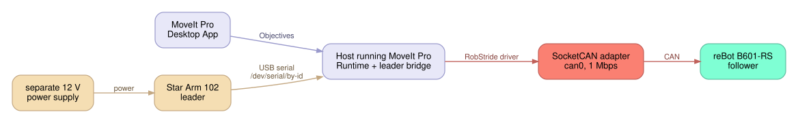

# Star Arm leader-follower demo

This demo connects a Star Arm 102 leader to the B601-RS follower through the
stock `rebot_b601_rs_hw` config's
[optional leader](../README.md#optional-star-arm-leader). It is for a
commissioned installation with a known leader calibration—not a substitute for
arm commissioning, CAN setup, or the manufacturer's independent stop and
power-isolation procedure. The follower has no brakes.



## Before starting

Use the matching hardware:

- A stable, powered reBot B601-RS with its native jaw and a host SocketCAN
  adapter.
- A Star Arm 102 leader powered from its **separate 12 V supply**, with its USB
  serial connection plugged into the MoveIt Pro host. The leader is USB serial;
  do not put it on the follower's RobStride CAN bus.
- A host running MoveIt Pro 10.x with this workspace and a known, calibrated
  Star Arm mapping.

<!-- markdown-link-check-disable -->
Bring up the physical CAN bus by following the [reBot B601-RS setup guide
PR](https://github.com/PickNikRobotics/moveit_pro/pull/24466).
<!-- markdown-link-check-enable -->
That guide owns adapter selection, host SocketCAN setup, power, zero/sign
checks, and initial commissioning; this page does not duplicate those
instructions. The selected
bus must be available on the host before Runtime starts. Use the host-network
physical deployment—do **not** pass `--instance`, because a named instance does
not expose the host SocketCAN interface.

### Connect the leader

1. Wire the Star Arm to its separate manufacturer-specified 12 V supply.
   Connect its USB serial cable directly to the host. Confirm that the stable
   `/dev/serial/by-id/...` symlink exists; do not depend on a changing
   `/dev/ttyUSB*` name.
2. Give the account that opens the serial device `dialout` access, then start a
   new login session:

   ```bash
   sudo usermod -aG dialout "$USER"
   ```

   The workspace image also adds its runtime user to `dialout`. Verify the host
   device permissions and the container-visible `/dev` device before launch.
3. Enable the leader in a child config of `rebot_b601_rs_hw`, as shown in the
   [stock README](../README.md#optional-star-arm-leader): set
   `rebot_leader_enabled: true`, add the leader Objective library, Behavior
   loader and `leader_position_controller`, and set `rebot_leader_port` to that
   `/dev/serial/by-id/...` path if it differs from the default. The office
   [`picknik_boston_rebot_b601_rs_hw`](../../picknik_boston_rebot_b601_rs_hw/config/config.yaml)
   config already does this. The stock
   [calibration file](../config/leader_calibration/rebot_arm_102_leader.json)
   is the Seeed stored-origin format, with zero homing offsets; the reader
   refuses any other convention, so the leader's origin must already be stored
   in its servos by the Seeed calibration procedure. Do not write leader origin
   data during the demo.

## Start MoveIt Pro

Build the selected workspace after changing configuration, then start the
physical Runtime from its root:

```bash
moveit_pro build --user-workspace "$PWD" user_workspace
moveit_pro run --user-workspace "$PWD" \
  --config-package <your leader config> --headless
```

On the office bench, the config package is `picknik_boston_rebot_b601_rs_hw`.

`moveit_pro run` starts the Runtime and drivers. Open the separately installed
MoveIt Pro Desktop App and connect it to that Runtime. Wait for the robot model,
planning scene, and leader bridge to become available before running an
Objective. If the Star Arm is unplugged or unpowered, reconnect it while reBot
is at HOME and restart Runtime; the reader does not reopen its serial port.

## Run Mirror

Keep people clear, keep the Star Arm near the reBot HOME pose, and hold it
still for the initial handoff. Do not move reBot by hand to match the leader.

1. In the Desktop App Objective sidebar, select **Mirror reBot Leader** and
   click **Run**.
2. The driver first engages torque from the measured pose. reBot becomes rigid
   without jumping to an old command, checks the leader/follower prerequisites,
   then eases each joint toward the live Star Arm target.
3. Once the bounded ease-in reaches the handoff band, the bridge blends for
   0.5 seconds and switches to direct following. Move the Star Arm to move the
   follower. Native FCL path checking runs for each published target.
4. Click **Stop** on the active Mirror Objective when the demonstration is
   complete. Do not start another motion Objective while the recovery is in
   progress.

Mirror requires fresh leader and follower feedback, a ready collision scene,
healthy motors, and reBot at HOME. A gross leader/follower mismatch, stale
sample, collision refusal, clutch, timeout, or Stop ends following and starts
HOME recovery. See [behavior details](rebot-behaviors.md#mirror-rebot-leader-catch-up-and-recovery).

## What Stop does

A normal Stop makes the bridge return reBot to HOME under power. After HOME
succeeds, it requests **Relax at HOME** once. Relax verifies all seven measured
joints, stillness, health, and an idle leader before disabling torque. The
Objective caller must first finish or cancel all trajectory, teleoperation, and
queued motion. A failed HOME or rejected relax leaves torque on; it never
disables torque away from HOME.

If **Start Gravity Comp** was run earlier, first run **Stop Gravity Comp** and
wait for it to finish before Mirror. Start Gravity Comp leaves arm `kp` at zero,
so Mirror currently drives only the jaw until spring stiffness is restored.

## Safe shutdown

1. Stop Mirror and wait for the HOME return and `Relax at HOME` result. If
   needed, run **Relax at HOME** only after all trajectory, teleoperation, and
   queued motion has been finished or cancelled.
2. Confirm the arm is at HOME and relaxed before removing motor power. The arm
   has no brakes; support it as required by the installation.
3. Use the manufacturer's independent power-isolation procedure. A software
   stop is not power isolation. If HOME or relax failed, leave torque on and
   use the supported recovery procedure with an operator rather than forcing
   torque off away from HOME.
