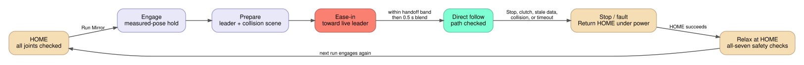

# reBot behavior reference

This page describes the physical `rebot_b601_rs_hw` configuration with the
[optional Star Arm leader](../README.md#optional-star-arm-leader) enabled, as in
the office `picknik_boston_rebot_b601_rs_hw` config. It is not a commissioning
guide. The arm has no brakes; a software stop is not power isolation.

## Motion lifecycle

### Relax at HOME and engage

**What you see:** `Relax at HOME` returns the arm to HOME while powered, then
the seven motors go limp while the driver and telemetry remain running. The next
physical `Return reBot Leader Home`, `Teleoperate`, or `Mirror reBot Leader` run
engages first and holds the measured pose before issuing motion.

**Why:** a relaxed arm must not resume an old controller reference, and torque
off is only allowed at a pose that has been qualified to support the unbraked
arm. The Objective checks that the leader is idle; the driver admits torque-off
only when all seven measured joints—including the jaw—are at a named safe pose,
within its tolerances, still, healthy, and inside measured bounds. Finish or
cancel trajectory, teleoperation, and queued motion before calling Relax: the
driver checks command stillness but cannot inspect Objective/action queues. A
refusal keeps torque on. Do not use `set_torque false` as a substitute.

**Tune:**
[`rebot_b601_rs_hw/config/relax_safe_poses.yaml`](../config/relax_safe_poses.yaml)
is the sole HOME definition. It supplies all seven positions, per-joint
tolerances, and stillness thresholds; the build derives the HOME waypoint, SRDF
state, and generated HOME/Relax Objectives from it. HOME is currently zero for
all joints with `0.08 rad` tolerances and a `0.3 s` / `0.005 rad` position-span
window. Do not widen a tolerance or add a pose to admit an untested arm state.
A new pose requires its own authorized torque-off settle test, then rebuilding
all affected configurations and restarting Runtime. See the [hardware service
contract](../README.md#relax-safe-poses-and-relax-at-home).

### Gravity compensation

**What you see:** hardware starts in spring mode, with JTAC position control and
the gravity controller active. `Start Gravity Comp` anchors the measured pose,
reduces arm damping, then sets arm stiffness (`kp`) to zero; the arm can be
manually floated while gravity feedforward stays active. `Stop Gravity Comp`
anchors again and restores spring gains. Neither Objective changes controllers,
returns HOME, disables torque, or changes gravity-model gains.

**Why:** the measured-pose anchor prevents the gain change from applying a stale
position target; Start is a damped float mode and Stop restores the configured
spring behavior.

**Known current limitation:** after `Start Gravity Comp`, a later `Mirror reBot
Leader` run drives only the jaw because arm `kp` remains zero. Run `Stop Gravity
Comp` and let it finish before running Mirror.

**Tune:** initial arm and jaw spring gains live in
[`rebot_b601_rs_mock/description/rebot.urdf.xacro`](../../rebot_b601_rs_mock/description/rebot.urdf.xacro).
Start/Stop use matching gain constants in
[`start_gravity_comp.xml`](../objectives/start_gravity_comp.xml)
and
[`stop_gravity_comp.xml`](../objectives/stop_gravity_comp.xml).
If spring gains change, update both Objectives as well. The stock gravity
controller gains are in
[`rebot_b601_rs_mock/config/control/rebot.ros2_control.yaml`](../../rebot_b601_rs_mock/config/control/rebot.ros2_control.yaml);
the office fit is selected by `boston_gravity_fit`, with its gains in
[`picknik_boston_rebot_b601_rs_hw/config/control/rebot.ros2_control.yaml`](../../picknik_boston_rebot_b601_rs_hw/config/control/rebot.ros2_control.yaml).
The mode contract and limits are in [gravity modes](gravity-modes.md).

### Teleoperation, waypoints, and pose jog

**What you see:** `Teleoperate` engages first, then starts in waypoint mode.
Joint jog controls arm or jaw joints; pose jog controls `gripper_end`; waypoint,
marker, and gripper Objectives use the trajectory controller. Controller
switching automatically leaves one owner per command interface. Mesh collision
checking is on with no added padding.

**Why:** the mode-specific controllers keep jog, pose, waypoint, and jaw
commands from claiming the same interface at once.

**Tune:** arm jog speed/acceleration are `0.3` / `0.6 rad/s²`; jaw values are
`3.0` / `6.0 rad/s²`; pose jog linear/angular limits, `0.2 s` command timeouts,
and the `0.02 rad` joint-limit margin are in the selected config's control
YAML, by default
[`rebot_b601_rs_mock/config/control/rebot.ros2_control.yaml`](../../rebot_b601_rs_mock/config/control/rebot.ros2_control.yaml).
Change a matched speed/acceleration pair only after validating stopping and
clearance on the installed arm. Waypoint Objectives expose velocity and
acceleration scales; their stored positions are in the package waypoints file.
Do not use a waypoint as a relax-safe pose without the separate torque-off
qualification above.

### Mirror reBot Leader catch-up and recovery

**What you see:** after `Mirror reBot Leader` starts, reBot first holds its
measured pose. It then eases each joint toward the *live* Star Arm target,
blends for `0.5 s` once it reaches the handoff band, and only then follows
directly. Keep the Star Arm near HOME and still during that transition. Mirror
requires fresh leader/follower feedback, a ready collision scene, healthy
motors, and reBot at HOME. It will not auto-start after USB recovery, a cleared
fault, or HOME.

With the stock SRDF, a folded rest reading such as J3 `-0.01 rad` is reported as
link2/link5 contact and refused; see the
[stock leader notes](../README.md#optional-star-arm-leader).

A Stop, clutch, stale sample, collision refusal, or engage timeout stops
following, returns HOME under power, and requests `Relax at HOME` once HOME
succeeds. Failed HOME or refused relax leaves torque on; do not disable torque
away from HOME.

**Why:** measured-pose engage avoids a jump to an old follower command, and the
bounded catch-up bridges the remaining leader/follower offset before direct
following.

**Tune:** `ros_global_params` in the selected config set arm ease-in speed
(`rebot_leader_engage_speed_rad_s`, default `0.2 rad/s`), jaw ease-in speed
(`rebot_leader_engage_jaw_speed_rad_s`, default `1.0 rad/s`), and the arm-only
gross mismatch gate (`rebot_leader_engage_max_offset_rad`, default `0.6 rad`);
the defaults are in
[`launch/rebot_leader.launch.py`](../launch/rebot_leader.launch.py). The bridge
checks every published candidate path against the native collision scene, using
the selected config's URDF and SRDF. These
are bounded-engage settings, not a direct-follow speed cap or safety rating.

### HOME-only motor tuning

**What you see:** the checked-in leader tuning file sets a voluntary jaw torque
limit and a joint4 speed limit. Its tool refuses a write unless feedback is
fresh, all motors are fault-free and off, and the arm is at HOME. It writes only
volatile registers and never saves motor parameters.

**Why:** the HOME/OFF gate prevents these direct motor writes from changing a
loaded or actively commanded arm.

**Tune:**
[`config/rebot_leader_tuning.yaml`](../config/rebot_leader_tuning.yaml) contains
`jaw_torque_limit_nm` (`1.0`) and `joint4_speed_limit_rad_s` (`33.0`). Change
only one of those documented values at a time and apply the file through
`rebot_leader_tune.py --apply` at healthy HOME/OFF. Do not use it during a
leader-follower session or use it to override native mechanical position limits.

### Driver limits, jaw continuity, and CAN pacing

**What you see:** bounded joints keep continuous feedback and targets across a
wrap-window edge. The jaw does not jump one full turn after a fast open/close.
The driver can also enforce optional soft joint limits: motion slows toward a
configured soft bound and does not cross it. This workspace does not currently
declare driver `soft_*` joint parameters.

**Why:** the driver folds bounded-joint feedback once at activation, then only
re-seeds after a greater-than-π SDK baseline step. It does not fold every read.
Its optional `soft_lower_limit`, `soft_upper_limit`, and `soft_k_position`
parameters are separate from URDF safety-controller limits, so they do not
narrow MoveIt planning bounds. J7's configured feedback allowance is `-0.15`
to `6.10 rad`; it is for measured transients, not more jaw travel.

Enable is paced one frame per motor per control cycle instead of sending one
large burst. A short `ENOBUFS`/`EAGAIN` condition is retried for 30 ms; an
unsent step is retried on the next cycle. The driver therefore works with the
kernel default queue of 10, while the workspace's `txqueuelen 1000` setup is
additional headroom.

**Tune:** add all three `soft_*` parameters together to the applicable
ros2_control `<joint>` in
[`rebot_b601_rs_mock/description/rebot.urdf.xacro`](../../rebot_b601_rs_mock/description/rebot.urdf.xacro)
only after a per-joint limit review. J7's feedback bounds are the
`jaw_lower_limit` and `jaw_upper_limit` values in that same model; do not widen
them to accept a bad zero or mechanical fault. Change the host CAN queue with
the driver’s
[`setup_can.sh`](https://github.com/PickNikRobotics/robstride_hardware_interface/blob/f72b2d2b52bed069a68254a16b5ece2351bc3b47/scripts/setup_can.sh),
not from a running Objective. The full contracts are in the pinned [driver
README](https://github.com/PickNikRobotics/robstride_hardware_interface/blob/f72b2d2b52bed069a68254a16b5ece2351bc3b47/README.md#soft-position-limits)
and the [jaw allowance](../../../README.md#jaw-feedback-allowance).
